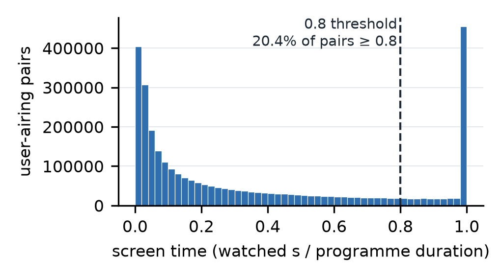
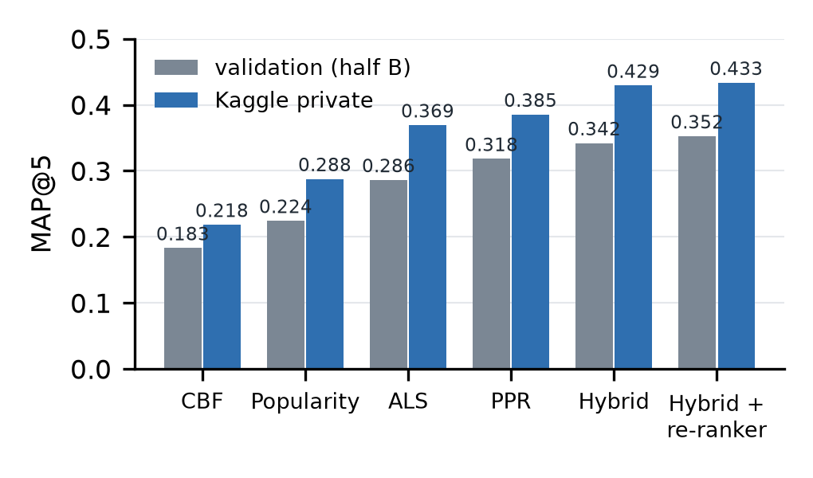
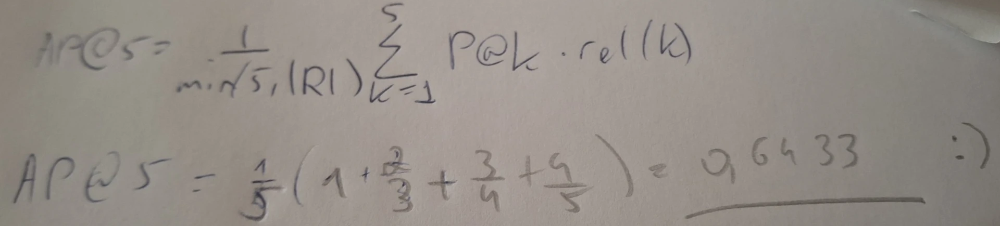

<<META Student: Anastasia Shavrina (Шаврина Анастасия Олеговна)>>
<<META Team: Individual>>
<<META Email: shavrina157@gmail.com>>
<<META Date: 2026-10-30>>
<<META Assignment: Final exam quiz (FKN) — TV programme recommendation on sweet.tv (Kaggle account: Maizawitch)>>
<<META Code: https://github.com/shavrinaanastasia/sweettv-recsys-exam>>
# LLM4Rec Final Exam Report — Repeat Viewing Dominates: TV Programme Recommendation on sweet.tv

## Abstract

We predict, for 1,260 sweet.tv users, the five TV programmes they will watch most often in weeks 31-42, given a channel-level view log (weeks 11-30) in which only about 11% of schedule rows carry a programme id. We join views to labelled airings with the host's own "≥ 80% watched" rule, compare a popularity baseline with implicit ALS, content-based filtering and personalized PageRank on one temporal hold-out, and combine them by score fusion followed by a LightGBM LambdaRank re-ranker. The final strategy reaches MAP@5 = 0.352 on untouched validation users (popularity: 0.224) and a returned Kaggle private score of 0.43344 (popularity: 0.28773). The main lesson is that this target rewards predicting repeat viewing on a user's habitual channels; content similarity alone does not even beat popularity.

*Index Terms — implicit feedback, personalized PageRank, matrix factorization, learning to rank, TV recommendation*

## 1. Introduction

**Problem.** sweet.tv logs which channel each user watched and when, and publishes the broadcast grid separately. For each of 1,260 test users we must output five programme ids, ordered, that best match the five programmes the user will watch most often (≥ 80% of an airing) in the next 12 weeks; the metric is MAP@5 [1].

**Motivation.** A TV service's home screen has room for a handful of tiles. If they reflect what a viewer will really come back to (the evening news, a children's series) the screen saves effort; if not, it is ignored. The data also forces two non-trivial steps: views must first be turned into user-programme interactions, and every method must extrapolate forward in time.

**Concrete example.** User 8377619604347126107 watched 179 airings to ≥ 80% in weeks 11-20, spread over 22 programmes. In weeks 21-30 their five most-watched programmes were 'ТСН. Неделя', 'Сегодня. Итоги', 'Факты. День', 'Завтрак с 1+1' and a 'Свинка Пеппа' series id — all five already in their history. Personalized PageRank returns exactly these five (AP@5 = 1.0, Table 4).

**Contributions.** (i) A reproducible join that applies the host's label recipe, and a validation set built with the same recipe. (ii) A like-for-like comparison of four methods plus a channel-exposure signal, and a two-stage hybrid whose gain over every single method holds both on held-out validation users and on the Kaggle private split.

## 2. Related Work

Prior work consulted:

- **Implicit-feedback matrix factorization** [2] turns counts into binary preference with a confidence weight and solves it by alternating least squares; our M1 implements those update equations directly.
- **Personalized / topic-sensitive PageRank** [3] biases the random-walk restart vector towards a chosen set of nodes; our M3 restarts on each user's own history over a programme co-view graph.
- **Content-based recommendation** [4] builds item vectors from attributes and a user profile from liked items; our M2 uses TF-IDF over category, genres, decade, director and actor tokens.
- **Learning to rank**: LambdaMART [7] optimises a ranking metric through gradient-boosted trees; we use the LightGBM implementation [6] for the re-ranking stage.
- The competition page [1] defines the data, the metric and the exact label recipe.

*Alternatives considered.* Association rules [5] were not implemented: with 6,000+ programmes and per-user baskets dominated by daily repeats, rules mostly restate "watches A → watches A again", which history already captures. Sequence models (session RNN / transformers) were not tried: views are channel intervals, not item clicks, and only 20 weeks of history exist. A two-tower model was not tried for the same reason and because the hand-built graph and factorization already give strong collaborative signals at a fraction of the cost.

## 3. Method

**Approach.** Turn the view log into (user, programme, number of airings watched ≥ 80%) interactions, score every candidate programme with each method, and rank. Every method shares one candidate pool, one fallback and one evaluation protocol. The final system uses the fixed-weight score fusion of all signals as a candidate generator (top 150 per user) and re-orders those candidates with a LambdaRank model.

**Pipeline.**
- *Join.* A view (user, channel, [start, stop]) is matched to a schedule row on the same channel whose airing [start, start + duration] overlaps it. Overlap seconds of all of the user's views are summed per airing and capped at the airing duration. *Watched* means overlap / duration ≥ 0.8 — exactly the host's label rule [1]. Figure 1 justifies this cut on the data as well: screen time is U-shaped (zapping near 0, full watches at 1), and 0.8 sits in the flat valley, so small changes to it move few pairs. 20.4% of 3,014,129 user-airing pairs pass.
- *`tv_show_id = 0`.* Unlabelled airtime is never an item (the host removed it from the labels). It is used only as context: each user's viewing seconds per channel, over **all** airtime, feed the channel-exposure signal below.
- *Labels* (validation): per user, count airings watched ≥ 0.8 per programme in the target weeks, keep users with ≥ 5 such programmes, take the 5 most frequent (ties: more watched seconds).
- *Candidate pool:* labelled programmes that air in the target weeks — for the test, read from the weeks 31-42 *schedule* only. Re-recommending a programme the user already watched is **allowed for every method** (the target is repeat-heavy, and the host does not forbid it).
- *Fallback:* empty slots are filled from the popularity ranking, identically for every method. Each method turns its scores into a list by sorting its own scores inside the pool; scores are never compared across methods without per-user min-max normalisation.

{w=7.2}

**Methods.**
- *Popularity (baseline):* recency-weighted number of airings of the programme watched ≥ 0.8 by all users in the train weeks (half-life 4 weeks).
- *History (reference, not a counted method):* the user's own count of ≥ 0.8 airings per programme.
- *M1 implicit ALS* [2]: r = recency-decayed counts, confidence c = 1 + α r; 16 factors, λ = 30, α = 1, 10 iterations, seed 42.
- *M2 content-based* [4]: TF-IDF item vectors over 17,193 metadata tokens; user profile = count-weighted sum of watched items; cosine score.
- *M3 personalized PageRank* [3]: item graph with edge weight = number of users who watched both items ≥ 20 min; row-normalised; restart probability 0.3 to the user's normalised history; 20 power iterations.
- *Channel exposure (context signal):* Σ over channels of (user's share of viewing seconds on channel c) × (airings of the item on c in the target weeks).
- *Hybrid:* per-user min-max normalised scores, weighted sum; weights by coordinate ascent on validation half A: channel 2.0, PPR 1.5, history 0.75, ALS 0.5, CBF 0.1, popularity 0.05.
- *Final: hybrid + re-ranker:* top 150 fused candidates per user, re-ordered by LightGBM LambdaRank [6], [7] (300 trees, learning rate 0.05, 31 leaves, ≥ 100 rows per leaf, bagging 0.8, seed 42, deterministic) on 31 features: every component's raw score, normalised score and rank, fused score and rank, watch counts and seconds, target/train airing counts and their ratio, user activity. Relevance = 5 for the label's #1 down to 1 for #5.

**Key design decisions.** (1) *Use the host's 0.8 rule rather than an absolute-seconds cut,* because the score is computed on labels built with it; an absolute cut would mislabel long films and short news equally. (2) *Fit the re-ranker without validation labels:* for validation it learns history 11-15 → labels 16-20 and is then scored on 11-20 → 21-30; for the test it learns 11-20 → 21-30 (training data at that point) and is applied to 11-30 → 31-42. (3) *Keep PPR's full graph* (dense matrix product) after pruning to the 50 strongest edges per item cost up to 0.05 MAP (§5).

**Tools & configuration.** Python 3.11.9; numpy 2.4.6, pandas 3.1.0, scipy 1.17.1, pyarrow 26.0.0, LightGBM 4.7.0 (native `lgb.train` API), matplotlib 3.11.2, reportlab 5.1.0, Kaggle CLI 2.2.5. ALS and PPR are implemented from the equations in [2], [3] (`src/methods.py`), not from a library. Windows 11, 8 logical CPUs, 16 GB RAM, no GPU. Seeds: user A/B split 0, ALS 42, LightGBM 42. Runtime: parse 42 s, join 12 s; scoring the 1,260 test users: PPR 41 s, ALS 6 s, CBF 0.3 s (`results/predict_summary.json`); re-ranker test run 183 s end-to-end.

## 4. Experiments

**Setup.** View log: 5,821,987 views by 4,914 users on 202 channels (weeks 11-30); schedule: 381,892 labelled airings. Only 10.8% of schedule rows (16.0% of airtime) carry an id, yet 52.4% of all viewing seconds fall on that labelled airtime. *Validation split:* train weeks 11-20 → labels from weeks 21-30, giving 4,030 users with five labels (1,150 of them are Kaggle test users). The test target window is later than all training weeks, so this split preserves temporal order and has a similar history-to-horizon shape (10/10 weeks vs. 20/12 for the test). Users are split 50/50 at random (seed 0): every hyper-parameter and fusion weight is chosen on half A (2,048 users); half B (1,982 users) is reported untouched, mirroring the leaderboard's public/private user split [1]. Cold start: all 1,260 test users appear in the training log, so there is no user without any views; 22 of them have fewer than five programmes with ≥ 0.8 history, so their history-only list is topped up from the popularity fallback (`results/predict_summary.json`).

| Method | Val. A | Val. B (untouched) | Val. test users | Kaggle public | Kaggle private |
|---|---|---|---|---|---|
| Popularity (baseline) | 0.2226 | 0.2244 | 0.2486 | 0.30344 | 0.28773 |
| History (reference) | 0.3105 | 0.3029 | 0.3468 | — | — |
| M1 implicit ALS | 0.2890 | 0.2862 | 0.3120 | 0.37750 | 0.36917 |
| M2 content-based | 0.1871 | 0.1831 | 0.2036 | 0.22711 | 0.21839 |
| M3 personalized PageRank | 0.3239 | 0.3182 | 0.3610 | 0.39959 | 0.38530 |
| Channel exposure (signal) | 0.3227 | 0.3192 | 0.3477 | — | — |
| Hybrid, fixed weights | 0.3484 | 0.3420 | 0.3810 | 0.44153 | 0.42921 |
| **Hybrid + re-ranker (final)** | **0.3563** | **0.3524** | **0.3933** | **0.43978** | **0.43344** |
Table 1: MAP@5. Validation = train 11-20, labels 21-30; Kaggle = train 11-30, hidden labels 31-42. Sources: `results/hybrid_val.json`, `results/rerank_val_n150.json`, `results/kaggle_submissions.csv`.

{w=7.6}

**Comparison vs. baseline.** Every collaborative signal beats popularity by a wide margin: ALS +0.062 and PPR +0.094 on half B; the final strategy +0.128 on half B and +0.146 on Kaggle private. Content-based filtering is the only method below the baseline (−0.041 on B). The methods rank in the same order on validation and on Kaggle private (Figure 2); Kaggle scores are higher overall, plausibly because test predictions use 20 instead of 10 weeks of history — a hypothesis we did not test.

**Hybrid and ablation.** Removing one component from the fixed-weight hybrid (half B, `results/hybrid_val_run1.json`): channel −0.019, PPR −0.004, history −0.002, CBF −0.001, popularity −0.000, ALS +0.000. A second weight search with a wider grid (up to 6.0) ended *lower* on half A (0.3477 vs. 0.3484) and was not used. The re-ranker was compared over two candidate depths and two model sizes on half A (150 candidates, small model best); recall of the label inside the 150 candidates is 0.767, which bounds what re-ranking can recover.

**Tuning record.** ALS needed three grids because the best point twice sat on the grid edge; the final λ = 30 beats 10 and 100. Weighting ALS by watched seconds instead of ≥ 0.8 counts collapsed MAP to 0.02-0.06 (plausibly because zapping visits then dominate; not tested further). Every grid point, including the losing ones, is logged in `results/val_runs.log` and `results/val_log_*.json`.

**Verification.** (i) MAP@5 code reproduces the course slide's worked example (AP = 0.917 and 0.533). (ii) One user-airing overlap recomputed from the raw CSV with the standard `csv` module equals the join output (5,973 s of a 6,000 s film). (iii) All 4,030 validation label sets contain 5 distinct programmes, each watched ≥ 0.8 in weeks 21-30. (iv) ALS objective decreases every iteration (49,593 → 26,627 over 6 iterations). (v) PPR transition rows sum to 1, and each user's score vector keeps total mass 1. (vi) Each submission file has 1,260 rows, five distinct non-zero ids from the test-week pool, and was scored COMPLETE by Kaggle. (vii) The dense and sparse PPR implementations return the identical score (A = 0.32295) on the same graph. (viii) I computed AP@5 by hand for the heavy viewer's popularity list (Table 4), using AP@5 = (1 / min(5, |R|)) · Σₖ P@k · rel(k): the hits are at ranks 1, 3, 4 and 5 and |R| = 5, so AP@5 = (1/5)(1 + 2/3 + 3/4 + 4/5) = 0.6433, the same value the code reports (`results/examples.json`); my working is shown in Figure 3. Sources: `results/checks.json`, `src/checks.py`.

{w=7.5}

### 4.1 Recommendation examples

Users were chosen by a fixed rule, not by inspecting results: among validation users who are also Kaggle test users, the one closest to the 90th percentile of training activity (heavy) and the one closest to the 10th percentile (light). Lists are from the validation models (train 11-20) so they can be compared with what the users actually watched in weeks 21-30. Titles are the schedule text of the programme's latest airing. One id can cover many airings with different titles: 12002955 appears under 207 episode titles of 'Свинка Пеппа', and 2400480 covers both the weekly 'ТСН. Неделя' and the daily 'ТСН.' news. In Tables 4-5, **bold** = in the user's actual weeks 21-30 label; ⁿ = not watched ≥ 80% by this user in weeks 11-20.

<<INCLUDE examples_tables.md>>

### 4.2 Kaggle submission

{w=10}

The designated final submission is `submissions/submission_rerank.csv` (ref 57803755), chosen on validation before its Kaggle score was known.

<<INCLUDE my_sections.md>>

<<PAGEBREAK>>
## References

[1] ogurbych, "sweet.tv — TV program recommender," Kaggle community competition, 2020. [Online]. Available: https://www.kaggle.com/competitions/sweettv-tv-program-recommender. [Accessed: 2026-10-30].

[2] Y. Hu, Y. Koren, and C. Volinsky, "Collaborative filtering for implicit feedback datasets," in *Proc. 8th IEEE Int. Conf. Data Mining (ICDM)*, 2008, pp. 263-272, doi: 10.1109/ICDM.2008.22.

[3] T. H. Haveliwala, "Topic-sensitive PageRank," in *Proc. 11th Int. Conf. World Wide Web (WWW)*, 2002, pp. 517-526, doi: 10.1145/511446.511513.

[4] M. J. Pazzani and D. Billsus, "Content-based recommendation systems," in *The Adaptive Web*, LNCS, vol. 4321. Berlin, Germany: Springer, 2007, pp. 325-341, doi: 10.1007/978-3-540-72079-9_10.

[5] R. Agrawal, T. Imieliński, and A. Swami, "Mining association rules between sets of items in large databases," in *Proc. ACM SIGMOD Int. Conf. Management of Data*, 1993, pp. 207-216, doi: 10.1145/170035.170072.

[6] G. Ke, Q. Meng, T. Finley, T. Wang, W. Chen, W. Ma, Q. Ye, and T.-Y. Liu, "LightGBM: A highly efficient gradient boosting decision tree," in *Advances in Neural Information Processing Systems 30 (NIPS 2017)*, 2017. [Online]. Available: https://proceedings.neurips.cc/paper/2017/hash/6449f44a102fde848669bdd9eb6b76fa-Abstract.html. [Accessed: 2026-10-30].

[7] C. J. C. Burges, "From RankNet to LambdaRank to LambdaMART: An overview," Microsoft Research, Tech. Rep. MSR-TR-2010-82, Jun. 2010. [Online]. Available: https://www.microsoft.com/en-us/research/publication/from-ranknet-to-lambdarank-to-lambdamart-an-overview/. [Accessed: 2026-10-30].
